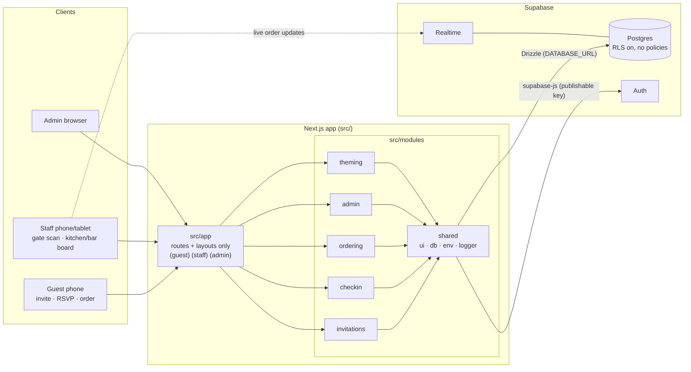

# Architecture

## Overview

One Next.js 16 app (App Router, Cache Components) talking to one Supabase project. Guests use their phones; staff use phones at the gate and tablets in the kitchen/bar; the couple uses the admin area.

## Layers

| Layer           | Location                                           | Rules                                                                                                                                  |
| --------------- | -------------------------------------------------- | -------------------------------------------------------------------------------------------------------------------------------------- |
| Routes          | `src/app/**`                                       | Routing, layouts, metadata. Call module components/actions. No logic or queries.                                                       |
| Feature modules | `src/modules/{invitations,checkin,ordering,admin}` | `components/` (UI), `server/` (queries + Server Actions, `server-only`), `lib/` (pure logic + Zod), `__tests__/`                       |
| Theming         | `src/modules/theming`                              | Theme JSON → validated (Zod + WCAG AA) → CSS variables. Event settings select the light/dark pair; `config.ts` supplies safe defaults. |
| Shared          | `src/modules/shared`                               | Base UI (`components/ui`), DB (`server/db`), env (`lib/env`, `server/env`), logger, security headers.                                  |

Dependency direction: `app → feature modules → theming/shared`. Never the reverse.

## Rendering and theming

- The root layout renders the light and dark themes as one server-side `<style>`: light on `:root`, dark inside `@media (prefers-color-scheme: dark)`. Each guest sees the theme matching their device setting. The cached database pair is rendered into the server HTML, so there is no flash of the wrong theme and no client JS for theming. Nothing writes theme variables inline on `<html>`; an inline style would beat the media query.
- Theme activation persists a validated pair and expires its cache tag. Private response headers remain no-store even though the public palette is cached; see [theming](theming.md) for outage and multi-instance limits.
- Tailwind 4 maps utilities to those variables (`src/app/globals.css`). The default palette is removed, so only token classes exist.
- Any element can render in another theme by applying `themeStyle(theme)` to it (used by `/dev/theme`).

## Data

- Schema: `src/modules/shared/server/db/schema.ts` (Drizzle). Migrations: `drizzle/` via `pnpm db:generate` / `pnpm db:migrate`. See ADR 0003.
- Tables: `invitations`, `guests`, `rsvps`, `check_ins`, `tables`, `menu_items`, `orders`, `order_items`, `staff`, `themes`.
- Server code connects to Postgres directly with `DATABASE_URL`. Every table has RLS enabled with no policies, so the browser's publishable key cannot read or write data. Features that need direct browser access (e.g. Realtime on `orders`) must add a narrow policy and an ADR.
- Offline check-in (planned): scans are queued on the device with a `client_event_id` (unique) so retries are idempotent.

## Cross-cutting

- **Env**: Zod schemas in `shared/lib/env/schema.ts`; validated at server start in `src/instrumentation.ts`.
- **Errors**: `app/error.tsx` (route), `app/global-error.tsx` (root layout), `app/not-found.tsx` (404). Expected errors are return values.
- **Logging**: `createLogger({ module })` — JSON lines in production, readable in dev, sensitive keys redacted. Server Actions call `runLoggedAction` for request IDs and safe lifecycle logs; see [observability](observability.md).
- **Security headers**: `shared/lib/security-headers.ts`, applied in `next.config.ts` (CSP, HSTS, frame-ancestors none, camera allowed on self only). See ADR 0006.

## Testing

- Vitest unit tests in each module's `__tests__/`.
- Playwright: `e2e/smoke.spec.ts` (`@smoke`, mobile + desktop) runs in `pnpm verify`; `e2e/visual/` makes screenshots for review.
