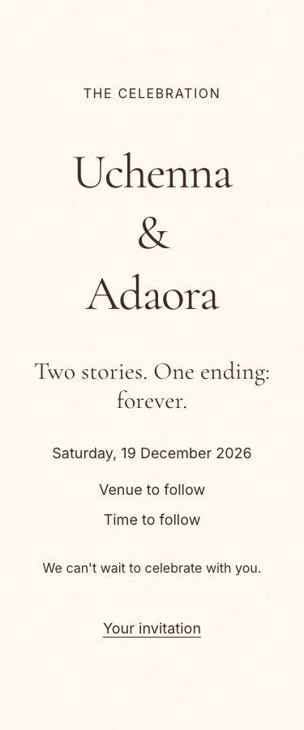

# Ticket

Ticket: TICKET-014

# Summary

The default light preset used tan backgrounds, gold primary controls and a burgundy accent despite the approved ivory/champagne/chocolate palette. It now uses ivory #FFF9EF for the page, chocolate #432B22 for text/primary controls/focus, and champagne #D6BE8D for secondary and decorative fills.

# Changes

- Update the existing ivory-gold JSON so saved preset IDs and default configuration continue to work.
- Preserve dark themes, semantic status colours, fonts, geometry, texture and existing QR ink/paper.
- Expand the palette contract and update the CSS serialization expectation. Fix the draft-copy regression fixture to mutate to a genuinely different colour; it still proves the original preset remains unchanged.
- Document preset behavior. Custom published palettes keep their saved values; no settings or database rows are rewritten.

# Acceptance criteria and evidence

The theme passes the existing AA gate across all registered themes. Screenshots of `/` and `/dev/theme` at 375/768/1280 in all four themes are in `docs/reviews/TICKET-014/screenshots/`. Independent source review found no blockers. Final couple visual approval remains an explicit TICKET-008 release requirement, not claimed here.

# Verification

- Exact approved palette contract: one red test before implementation.
- `pnpm exec vitest run src/modules/theming`: 163 passed.
- Production build: passed. Database-free previews intentionally use approved defaults.
- Production screenshot suite: 24 passed, no horizontal overflow.
- Theme review, base component accessibility and motion browser suites: 15 passed, including all-theme axe, 44px targets, keyboard focus/trapping, reduced motion and long-name wrapping.
- Focused draft-copy and actual QR pass-image suite: 4 passed with unchanged timeouts. An earlier parallel run hit a 5s image timeout during simultaneous build/browser work; the isolated rerun passed in 2.61s.
- `pnpm verify:quick`: lint/types pass; 291 related tests pass, nine opt-in database tests skipped (no database changes or local stack).

# Risks and rollout

No migration, dependency or account changes. Preset consumers update on deployment; already published custom token objects retain their saved values. Rollback reverts the theme JSON. QR ink/paper and quiet zones are unchanged. Physical-device/WhatsApp checks and fresh Lighthouse/CLS measurements are not certified by this colour-only change; the standing preview approval retains TICKET-201 as a mandatory release gate. This is implementation approval, not final couple visual approval.

# Screenshots

All 24 full-page captures are under `docs/reviews/TICKET-014/screenshots/`; local 900px slices remain in ignored `artifacts/screenshots/` for close inspection. Reviewed all home combinations and the component showcase’s full mobile slices; no clipping or unintended palette change observed.

# UI checklist

- PASS screenshots: required routes × four themes ×375/768/1280 captured; no overflow assertions fail.
- PASS tokens: only canonical theme JSON changes; no component literals or new token/schema.
- PASS restraint/typography: existing geometry/fonts unchanged, chocolate controls and champagne decoration inspected.
- PASS mobile/keyboard: 44px targets, focus contrast, sheet trap/Escape/return and name wrapping browser checks pass.
- PASS motion: existing timing/property and reduced-motion checks pass.
- PASS contrast: all registered theme AA contracts and rendered axe scans pass.
- NOT VERIFIED load/performance: no fresh Lighthouse or CLS certification; unchanged layout/font/image source. Retained release gate TICKET-201.
- PASS copy/shared components: no copy or component changes; existing shared showcase reviewed.
- NOT VERIFIED sharing/devices: physical WhatsApp/iOS/Android retained in TICKET-201.
- PASS automated QR: all-theme raster pass-image decode passes; ink/paper unchanged. Physical scan not re-certified.
- PASS staff meanings: semantic tokens unchanged; rendered panel typography and labels pass existing checks.
- Verification: production build, 163 theme units, four focused units and39 browser checks pass; scoped lint/types and 291 related tests pass (nine opt-in database skips). Full hosted CI remains required before merge.

# Harness changes, if any

None. The draft-copy fixture no longer assumes foreground and primary are different colours.
