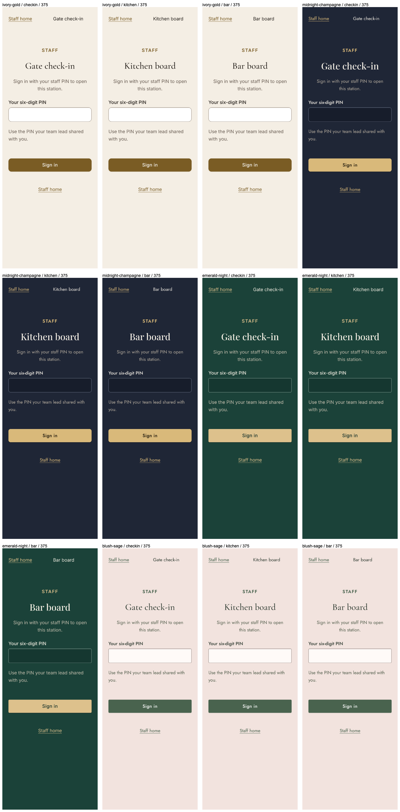

# Ticket

Ticket: TICKET-031

# Summary

Gate, kitchen and bar entry pages now require a six-digit staff PIN. Incorrect,
expired and locked-out attempts get distinct friendly messages; successful sessions
are bound to the browser device and cannot open a different role's station.
The owner approved proceeding to review with physical-device checks retained as mandatory release requirements in TICKET-201. Those checks remain unverified. The branch includes develop e051979 and passed its integrated full review gate.

# Changes

- Server-only asynchronous scrypt hashing with random salts and constant-time comparison.
- PostgreSQL row locking limits each device to five failures per ten-minute window.
- Signed httpOnly session/device cookies; every access checks current staff/device
  revocation, role, credential version and expiry. Duplicate PINs across roles fail closed.
- Session expiry is capped at venue-local 06:00 after the wedding, as specified in ADR 0020.
- Shared PIN form on three staff routes, with a harmless preview on `/dev/theme`.
- Approved generated migration 0011 adds the RLS-enabled device attempt table.

# Acceptance criteria and evidence

- Wrong, expired and locked states: isolated database tests and mobile/desktop production journeys pass.
- No hashes leave the server: server-only helpers, strict signed payload and browser HTML checks.
  Identity is staff ID and role; the payload also carries necessary expiry, issue-time and
  credential-version security metadata. It contains no name, email, PIN or hash.
- Gate/kitchen isolation: both directions pass in the production browser journey;
  duplicate credentials across roles are rejected by a database regression.

# Verification

- Three isolated database tests pass, including concurrent lockout, expiry and revocation.
- Repeat migration preserves row counts; all 15 public tables retain RLS.
- Credential/session/expiry/device-cookie tests pass; PIN suite includes 14 cases.
- Production staff journey: two browser projects pass in 14.3s.
- Focused UI/regression review: 20 passes, two opt-in skips.
- Delayed-font exact-zero CLS: 12 passes. Preview behavior: one pass.
- Standard screenshots: 48 cases pass across four routes, four themes and three widths.
- Final full `pnpm verify` passes: 878 unit passes (65 skips), 775 browser passes
  (165 skips; final integrated run 7.3 minutes), formatting, lint, types and production build.
  The initial run had nine browser failures;
  corrected typography, idle status semantics and isolated fixture scheduling now pass focused checks.
  See `docs/reviews/TICKET-031/ui-review.md` for retained evidence and limitations.

The first integrated review attempt hit one existing pass-image test timeout
(877 unit passes, one failure). Both image tests passed unchanged in isolation
in 1.24 seconds after the concurrent verification process exited. A full rerun
with one unit worker passed; no assertion or timeout changed. Logs:
`artifacts/TICKET-031/review-gate.log`, `pass-image-isolated.log`, and
`review-gate-serial.log`.

# Risks and rollout

Configure a private random 32-byte `STAFF_SESSION_SECRET` encoded as 64 lowercase hex
characters and real event/time-zone settings before enabling authentication. Missing
settings fail closed. No deployment secret or production database application is included.
Apply the approved generated additive migration with the normal deployment process.
Rollback application usage first; retain the table to preserve lockout counters. Removing
it would delete data and requires separate approval.

Clearing cookies creates a new device identity; broader abuse protection stays in
TICKET-185. Staff administration stays in TICKET-096, and scanner/board implementation
remains separate. Physical phone keyboards and operational devices remain unverified and are explicitly tracked in release-blocking TICKET-201 under the owner’s 2026-11-04 review deferral.

# Screenshots

Review `docs/reviews/TICKET-031/screenshots/` for all staff routes and
`docs/reviews/TICKET-031/preview/` for the changed shared-form preview, at 375/768/1280
in every theme. Contact sheets are in the same review folder. Original standard
captures are retained locally under `artifacts/screenshots/`.

# UI checklist

The item-by-item PASS/N/A/unverified report is `docs/reviews/TICKET-031/ui-review.md`.
Final full verification passes; physical staff device checks are not certified.
Guest WhatsApp/OG, guest Lighthouse and QR scan checks are not applicable because
this change affects staff authentication and its developer preview only.

# Harness changes, if any

No hooks, CI or shared verification rules changed. The isolated staff journey runner
uses a process-only ephemeral signing key and removes its own fixtures. Run it serially
with other fixture-changing tests. A per-worktree verification lock is proposed as a
separate follow-up after fixture interference in the initial broad run.
