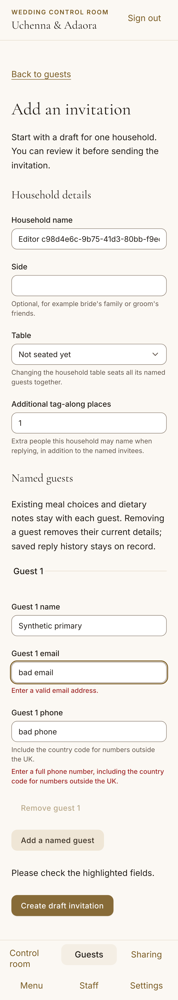
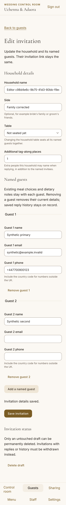

# Ticket

Ticket: TICKET-090

# Summary

Administrators can now create and correct invitation households from Guests. The forms validate names, phone/email, household side/table, named party members and extra tag-along allowance. New invitations receive a secure token and draft status. Untouched drafts can be deleted; published invitations use revoke/reissue controls.

# Changes

- Add authenticated `/admin/guests/new` and `/admin/guests/[id]/edit` routes and guest-list entry points.
- Authorize every mutation with the live admin session, validate input with Zod and lock the invitation before comparing a fingerprint covering invitation, members, RSVP and admission counter.
- Preserve capabilities, existing member meals/dietary notes, guest yes/no answers and original reply timestamps. Explicit attending-roster corrections update party size and append admin-attributed history; parties cannot shrink below admitted people.
- Preserve historical check-ins: removing their guest returns an expected error. Draft deletion also refuses any durable RSVP/lifecycle/admission/check-in evidence.
- Keep local fingerprints tied to edited values across server refreshes; adopt generated guest IDs after save so repeated edits preserve identities.
- Reuse lifecycle controls and refresh the editor after revoke/reissue. Successful deletion redirects to the guest list with a fixed, focused confirmation; successful creation also focuses its confirmation.
- Add a server-only invitation-history facade; existing guest history callers retain their default actor.

# Acceptance criteria and evidence

- **Creating an invitation generates a token and draft status:** unit tests verify draft planning; PostgreSQL and authenticated browser tests verify a fresh 43-character capability, version 1 and draft status.
- **Invalid phone/email show field errors:** mobile and desktop submit invalid contacts, assert both invalid fields and focus on the first error, then correct and save.
- **Create and edit journey:** real email/TOTP authentication, create, two successive edits with stable guest IDs/token, deletion confirmation/Escape/reopen, successful deletion redirect/focus, attending-roster correction with preserved reply timestamp/admin audit, and successful revocation/focus all pass.

# Verification

- Focused unit/action/form suite: **19 passed** (`/tmp/TICKET-090-editor-unit.log`).
- `RUN_INVITATION_EDITOR_DB_TESTS=1 pnpm exec vitest run scripts/__tests__/invitation-editor.integration.test.ts`: **6 passed**, rollback-only fixtures (`/tmp/TICKET-090-db-tests.log`). Includes stale RSVP/member/admission snapshots, admitted-count bounds, legacy check-in preservation, immutable reply history and default guest actor.
- `pnpm build`: **passed** (`/tmp/TICKET-090-build.log`).
- `pnpm exec tsx scripts/test-invitation-editor.ts`: **2 passed in 14.2s**, mobile and desktop (`/tmp/TICKET-090-browser.log`). Sixteen axe scans cover invalid and saved states across four palettes; no violations.
- `pnpm verify:quick`: **passed**, lint/types and 12 related tests; six opt-in database cases are separately executed above (`/tmp/TICKET-090-quick.log`). Full CI remains required before merge.
- Regression evidence: editor-route invalidation failed before its fix; historical guest removal failed before the preservation check; the browser reproduced a post-delete 404 before redirect/focus was added. Early browser harness attempts also corrected ambiguous global/lifecycle status locators, a retained hidden route's Side label, and a required synthetic fixture token. Assertions were retained.
- Integrated develop `ede359cace7afb253c66f3df79cb97f8478fbe97` (sharing/event closure) cleanly. Existing route-inventory regression exposed omitted editor metadata; both admin routes and a neutral dynamic sample are registered, and all five route tests pass. Normal merge precommit verification passes. Database/browser evidence predates this metadata-only editor integration; no fresh post-integration database run is claimed.
- Owned local database `wedding-30686dddb521` stopped with `backup:true` after verification; no other stacks touched.

# Risks and rollout

No schema migration, new dependency, CI change or production database operation. Existing RSVP/audit/admission protections remain enabled. Archived guests with historical check-ins may have their details corrected but cannot be removed. Revert this ticket's routes/modules for rollback; existing saved household corrections remain ordinary application data.

Physical-device release QA remains tracked separately. Admin-only lighter UI evidence applies under TICKET-217; this does not certify guest release performance or phone testing. The optional success notice accepts only the fixed `draft-deleted` enum and never echoes query text.

# Screenshots

`docs/reviews/TICKET-090/screenshots/` contains invalid and saved editor states for all four palettes, mobile 375px and desktop 1280px. Mobile screenshots include the entire form and bottom navigation; overflow assertions also pass at 768px. The screenshots are synthetic and contain no real guest data.

# UI checklist

- **Screenshots — PASS:** admin-required375px evidence plus all-theme desktop captures; visually reviewed for readable labels, wrapping and action clearance.
- **Tokens — PASS:** existing theme tokens and shared controls; no hard-coded colour/font/radius/shadow additions.
- **Restraint and typography — PASS:** household, named-guests and status sections; existing serif headings/body typography and spacing.
- **Mobile — PASS:** no overflow at375/768/1280; shared44px controls, full-page bottom clearance and visible validation.
- **Motion — PASS:** real journey runs reduced-motion; no new animation.
- **Keyboard — PASS:** validation focus, deletion Enter/Escape/reopen, success destination focus and revoke/reissue focus tested in both projects.
- **Contrast — PASS:**16 axe scans, zero violations, four themes and both relevant form states; textual errors supplement colour.
- **Load and images — N/A:** admin lighter evidence; no image or font changes. Exact cold-load CLS not measured by this ticket.
- **Performance — N/A:** admin-only changes; no guest Lighthouse claim.
- **Copy — PASS:** concise admin guidance explains roster corrections and historical preservation; no technical exception text exposed.
- **Shared components — PASS:** Button/Input/Select/Sheet and existing lifecycle controls reused; no new shared primitive.
- **Sharing and devices — N/A:** no guest sharing/device flow changes; physical release checks remain separate.
- **QR codes — N/A:** no QR output changes.
- **Staff feedback — N/A:** no scanner/staff feedback changes.
- **Verification — PASS locally:** quick gate, production build, targeted database/browser suites above. Full CI pending.

# Harness changes, if any

Only a ticket-scoped authenticated browser runner and rollback-only integration suite. No checks or hooks weakened. Reviewers should use visible role locators with confirmation text: Next retains hidden route DOM and this app has separate global/lifecycle status regions.
