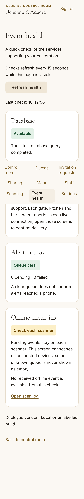
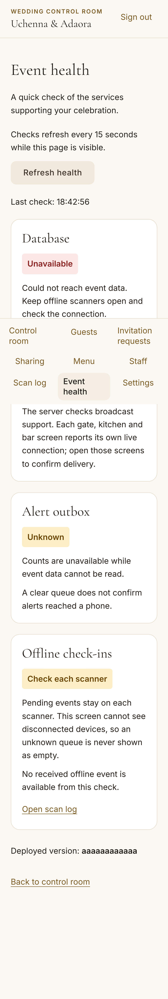

# Ticket

Ticket: TICKET-143

# Summary

Administrators can open **Event health** from the control room to check database access, broadcast support, alert backlog and the last received offline admission. The page refreshes every 15 seconds while visible and offers manual refresh. A database failure is red and labelled unavailable; disconnected scanner queues remain explicitly unknown.

# Changes

- Add `/admin/health` and an MFA-protected aggregate `/api/admin/health`. No guest details, invitation tokens, alert bodies or device credentials enter its response.
- Add public `/api/health`: a real bounded database probe returns only `{"status":"ok"}` (200) or `{"status":"unavailable"}` (503), with no-store headers. Public readiness does not query private counts.
- Bound each database probe to two seconds, cache results for five seconds and reuse an outstanding query after timeout so repeated requests cannot multiply stuck queries within one process.
- Show broadcast capability separately from delivery health; use explicit unknown outbox states on read failure. Display a bounded deployment SHA when Vercel supplies one.
- Clear private UI state on denied access or refresh failure; fence superseded requests, abort on unmount and stop polling when hidden or signed out.
- Extend existing admin navigation, journey documentation and the authenticated browser runner. The standard admin CI journey includes the new test; `--health` provides a focused local run.

# Acceptance criteria and evidence

- PASS: every dependency has a truthful state. Both authenticated browser projects check the real healthy database, a stubbed outage with red plus text, unknown outbox counts, disconnected-device messaging and expired sign-in clearing the view.
- PASS: public readiness exposes no internal details. Unit cases cover unavailable/throwing probes, generic output, access denial and private-field stripping; browser checks confirm the public JSON and private unauthenticated 403.

# Verification

Base: `ddc817558f79c1a33ea9b9feee5db7d4c7dea4d9`.

- `pnpm verify:quick`: lint and types pass; 134 related tests pass, nine opt-in tests skipped as configured. Health coverage includes 13 tests, including timeout/query deduplication and unknown-count handling.
- Production build via `pnpm exec tsx scripts/test-admin-journey.ts --build --health`: build passes. Initial browser run reached the visual assertions but failed on an ambiguous status locator (page status plus existing toast region). The locator was scoped to main; no assertion was removed.
- `pnpm exec tsx scripts/test-admin-journey.ts --health`: both mobile and desktop projects pass, including real isolated email/TOTP sign-in, all-theme axe scans, keyboard refresh, no horizontal overflow and 44px refresh target. The existing isolated migrations apply successfully. Owned database stopped afterward with its backup preserved.
- Independent source review found no blocking issues.
- Full local `pnpm verify` was not repeated under the focused verification policy. Required hosted CI must pass before merge; full verification remains required before release.

# Risks and rollout

No dependency, schema, environment setting, policy or CI workflow changes. Deploy the app normally; revert this ticket to remove the routes and navigation. Public readiness is intentionally database-dependent so uptime monitoring can notice an outage.

Broadcast support is configuration evidence, not proof that every live socket is connected. Disconnected device queues cannot be read remotely and are never presented as zero. A clear alert queue is not a delivery receipt. Probe caches/single-flight are process-local, not fleet-wide metrics. An underlying timed-out query is retained until it settles rather than cancelled; client/network and deployment timeouts remain in effect. No real phones or production outage were tested.

# Screenshots

Ten inspected Playwright images under `docs/reviews/TICKET-143/{mobile,desktop}/`: `healthy-375.png` and `unavailable-{ivory-gold,midnight-champagne,emerald-night,blush-sage}-375.png`. These show the existing fixed mobile navigation at its viewport position in full-page captures; content remains scrollable. No authentication factors were recorded.

# UI checklist

Admin/staff scope follows TICKET-217.

- PASS — Screenshots: 375px screenshots inspected in both browser projects and all four outage palettes; admin minimum satisfied.
- PASS — Tokens: changed component searched for literal colours/fonts/radii/shadows; uses existing semantic theme tokens only.
- PASS — Restraint and typography: one dependency per shared card, existing display/body fonts, restrained status colours and readable body text.
- PASS — Mobile: 375px overflow assertion in every theme, 44px refresh target, existing safe-area-aware shared navigation. No fields or new keyboard overlays.
- PASS — Motion: reduced-motion emulation used; no new animation or blocking transition.
- PASS — Keyboard: focus and Enter activate refresh; standard links/buttons and visible shared focus styles; no dialogs introduced.
- PASS — Contrast: zero axe violations in every theme in both browser projects; every status has text as well as colour.
- N/A — Load/images: no images or font changes; existing font setup reused. Exact-zero CLS measurement is outside this staff/admin scope, not newly certified.
- N/A — Performance: staff/admin scope; no guest flow touched and no new Lighthouse claim.
- PASS — Copy: concise operational wording, generic failures and explicit limits on what can be observed.
- PASS — Shared components: existing Card/Button/admin shell reused; no new generic pattern requiring a theme showcase.
- N/A — Sharing/devices and QR: no guest sharing, scanner feedback or QR output changed.
- PASS — Staff feedback: semantic success/warning/error tokens plus text, immediate refresh loading state and live status announcement.
- PASS — Verification: focused policy checks above pass; hosted CI is the merge gate. Full local verification not claimed.

# Harness changes

Only the existing authenticated journey runner gains the health fixture and focused selection. No checks, hooks or rules are weakened.
