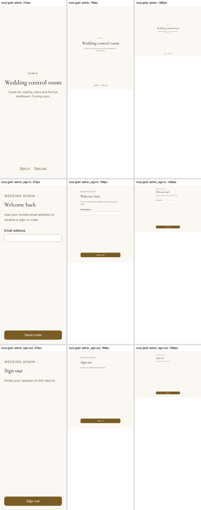
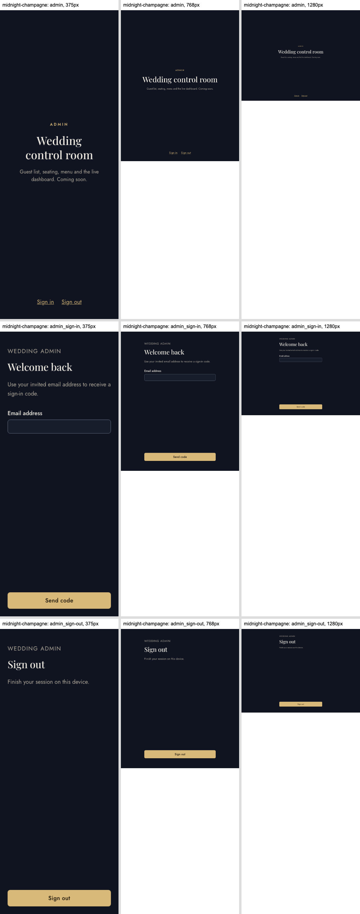
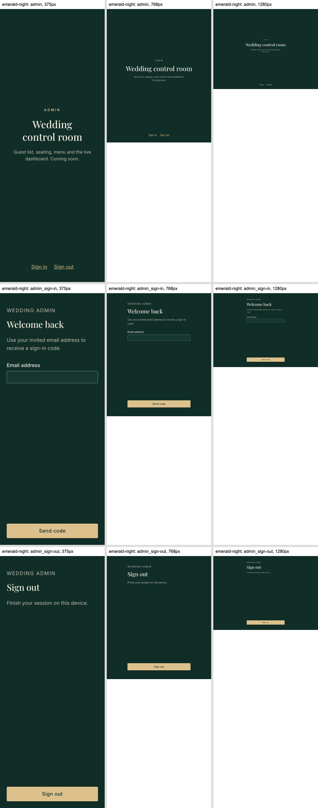
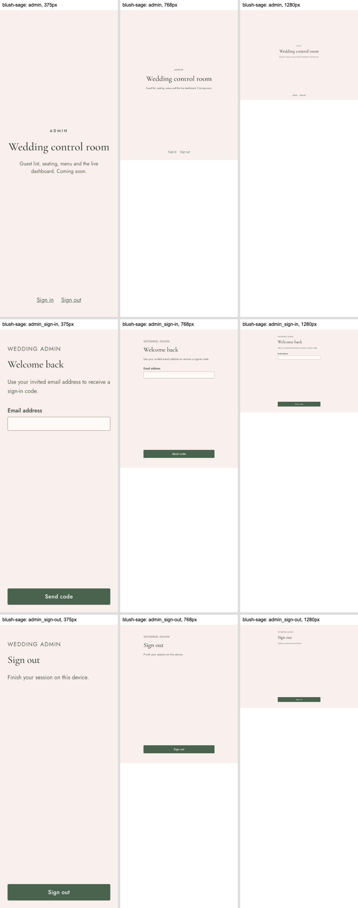

# TICKET-029 UI and auth review — 28 October 2026

Base develop eb0969c28a02dfd00513c7a93f8372731e7fabbb. Local project wedding-a8883405b4c2; app22890, browser22891, API22880, DB22881, mail22885.

## Evidence

- Eight auth boundary tests pass: normalized exact allowlist, deny-all default, unlisted/malformed rejection before Auth calls, malformed/invalid codes, verified identity mismatch, membership recheck and honest sign-out errors.
- Two cookie-policy tests cover HTTP local and HTTPS Secure/httpOnly/SameSite=Lax settings. Environment tests assert the empty default.
- Real local email-code browser flow passes on mobile and desktop: code delivery, wrong-code failure, successful verification, code replay rejection, httpOnly cookie visibility, no localStorage auth token and session removal on sign-out.
- All-theme responsive/accessibility and keyboard/reduced-motion checks pass. The heading regression asserts at least32px.
- Initial browser failures exposed ambiguous toast/status selectors and hidden form fields in the tap-size selector. Auth status now has an accessible name; hidden transport inputs are excluded from interactive target measurements. Screenshot review found and corrected an invalid heading utility.
- 36 screenshots generated and inspected: /admin, /admin/sign-in, /admin/sign-out across four themes at375/768/1280. Original images are under screenshots/; review sheets below.
- Full verification passed (449 browser checks, 123 conditional skips); the separate real OTP flow passed six checks. No physical-device or hosted email claim is made.

## UI checklist

| Item                 | Result and evidence                                                                                                                                              |
| -------------------- | ---------------------------------------------------------------------------------------------------------------------------------------------------------------- |
| Screenshots          | PASS:36 captured and visually reviewed; all original resolutions committed.                                                                                      |
| Tokens               | PASS: shared theme classes and controls; no custom literal colors, radii or shadows.                                                                             |
| Restraint/typography | PASS: one form action per stage; established type-heading,18px controls/body, plain staff/admin screens. Existing admin placeholder remains otherwise unchanged. |
| Mobile               | PASS:375/768/1280 no overflow, controls at least44px, flexible bottom actions with safe-area padding; no fixed overlay obscures fields.                          |
| Motion               | PASS: no new animation; reduced-motion browser checks pass. Shared button feedback retained.                                                                     |
| Keyboard             | PASS: semantic forms, labels, native keyboard controls, visible focus, focused named status on response; no dialogs.                                             |
| Contrast             | PASS: WCAG A/AA axe checks in every theme, including denied state. Shared token contrast tests remain enabled.                                                   |
| Load/images          | PASS: measured CLS 0 on mobile and desktop; no added images, existing next/font.                                                                                 |
| Performance          | N/A: admin routes only; no guest page changed.                                                                                                                   |
| Copy                 | PASS: short, provisional admin wording; no provider errors, codes or tokens exposed in messages/logs.                                                            |
| Shared components    | PASS: shared Input/Button; feature-specific auth form needs no new reusable base component.                                                                      |
| Sharing/devices      | N/A: admin-only flow, no guest links or WhatsApp journey changed. Physical phones not tested.                                                                    |
| QR                   | N/A: no QR change.                                                                                                                                               |
| Staff feedback       | PASS:18px text/controls,32px+ headings, pending state and focused status; no scanner/sound/haptic action.                                                        |
| Verification         | PASS: pnpm verify passed; 449 browser checks passed, 123 conditional checks skipped. Separate real OTP flow also passed.                                         |

## Review sheets

## Limits

Allowlist, production HTTPS and hosted email templates/SMTP require deployment configuration. Route guards and MFA are separate tickets; no claim that the admin placeholder is protected. Real Auth verification is opt-in locally and does not run in generic CI. See docs/admin-auth.md for reproducible commands and rollback.
