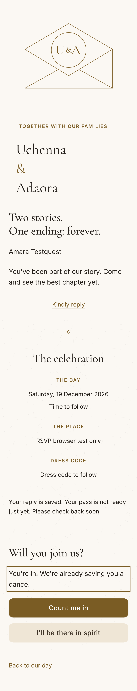
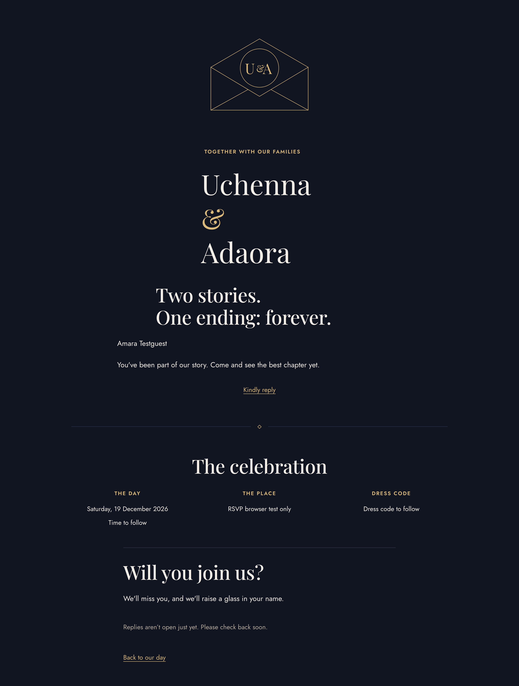
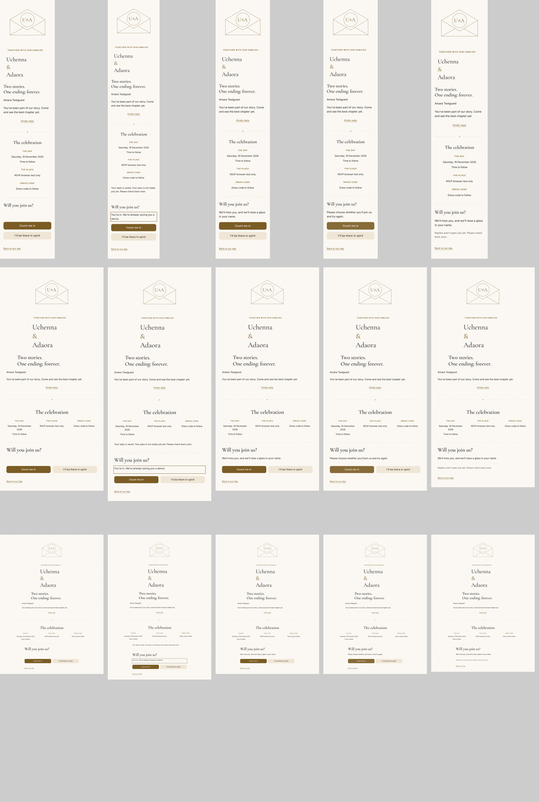
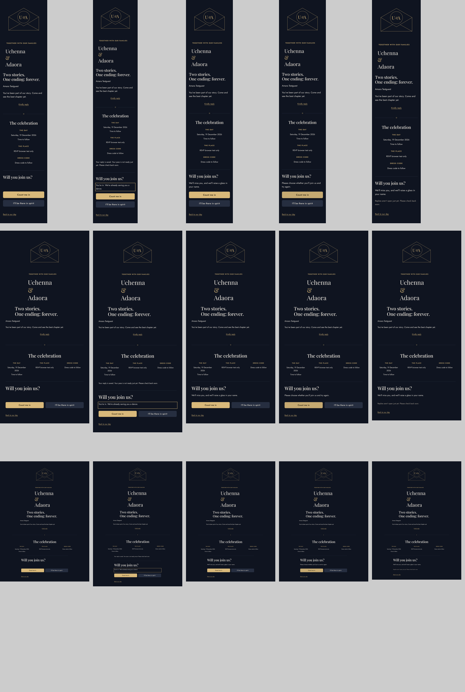
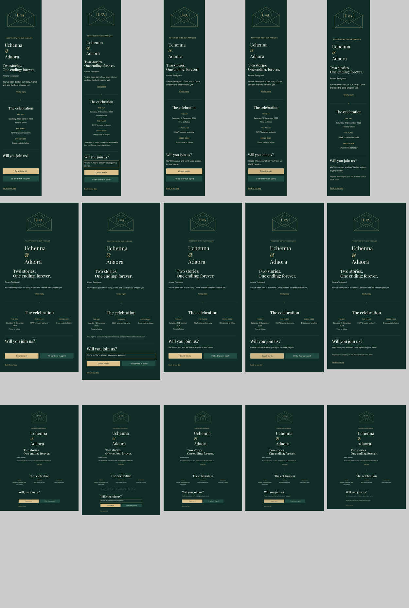
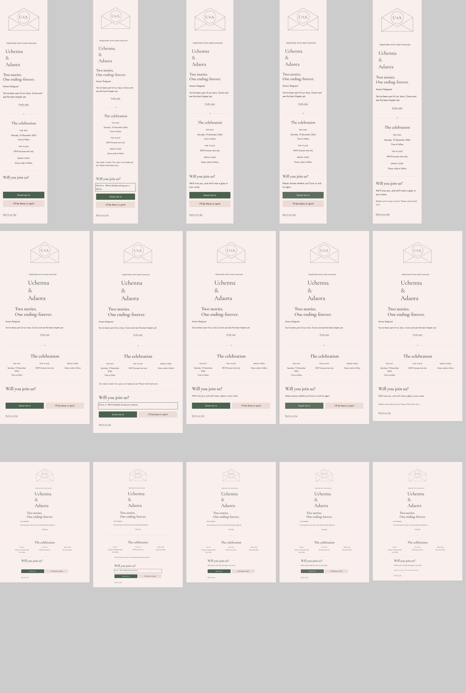

# TICKET-211 UI regression evidence — 2 November 2026

Decision: **CHANGES REQUESTED for full UI/release approval**. This ticket adds hidden revision/retry fields and actionable conflict/cutoff copy to the existing RSVP flow. It does not implement the approved new envelope/member editor. Source reference requires owner sign-in; fidelity is unverified. Base develop: `2f066ebbb175c4b8d42b0ab6f54545134f52f592`.

| Checklist item       | Result / evidence                                                                                                                                                                                                                                                             |
| -------------------- | ----------------------------------------------------------------------------------------------------------------------------------------------------------------------------------------------------------------------------------------------------------------------------- |
| Screenshots          | PASS for current RSVP regression: 60 full-page images, four registered themes × 375/768/1280 × initial/yes/no/error/closed. Inspected all four contact sheets and their full-page state captures. Full local set: `artifacts/TICKET-211/rsvp`; representative captures below. |
| Tokens               | PASS: changed components add hidden inputs/props only; no colour/font/radius/shadow literals or new tokens. Existing state copy uses shared controls.                                                                                                                         |
| Restraint/typography | PASS for unchanged invitation layout in inspected captures. New member editor/design integration remains outstanding.                                                                                                                                                         |
| Mobile               | PASS for reviewed widths: no horizontal overflow; every rendered button/link at least44×44. Physical keyboard/safe-area behavior not verified.                                                                                                                                |
| Motion               | PASS for reduced-motion browser review; no new animation. Reversible swipe intro remains missing.                                                                                                                                                                             |
| Keyboard             | PASS: keyboard navigation into reply, activation, response focus; current reply controls remain labelled. No new dialog.                                                                                                                                                      |
| Contrast             | PASS: zero Axe WCAG A/AA violations in all60 settled states. This is automated rendered contrast/accessibility evidence, not a complete manual accessibility certification.                                                                                                   |
| Load/images          | Not verified for CLS. No new images/fonts introduced; approved photography remains untouched.                                                                                                                                                                                 |
| Performance          | Not verified: no new Lighthouse mobile report. Production build passed; build success is not a performance score.                                                                                                                                                             |
| Copy                 | PASS: actionable refresh on stale household edits, contact-couple instruction after deadline, no database/provider detail exposed. Late-change approval workflow remains missing.                                                                                             |
| Shared components    | PASS: existing form/buttons/status; no new reusable visual pattern requiring `/dev/theme`.                                                                                                                                                                                    |
| Sharing/devices      | Not verified on actual iOS/Android WhatsApp or Open Graph previews. Chromium mobile/desktop emulation is recorded separately.                                                                                                                                                 |
| QR                   | PASS for local signed-pass browser regression; QR rendering unchanged. Physical camera scans not verified.                                                                                                                                                                    |
| Staff feedback       | N/A: this ticket changes guest RSVP only; staff workflows remain incomplete.                                                                                                                                                                                                  |
| Verification         | NOT PASS: full unit gate currently has three hook failures requiring human migration-file authorization; hooks remain enabled.                                                                                                                                                |

The first visual run caught absent title during streamed server-action metadata. The rerun explicitly requires `Your invitation · Our Wedding` before Axe measurement; all12 theme/viewport cases pass without suppressing a violation. See `artifacts/TICKET-211/visual-review-settled.log`.

## All reviewed states

Each contact sheet contains the complete page in initial/yes/no/error/closed columns and375/768/1280 rows. Full-resolution originals remain in the local artifact directory.

